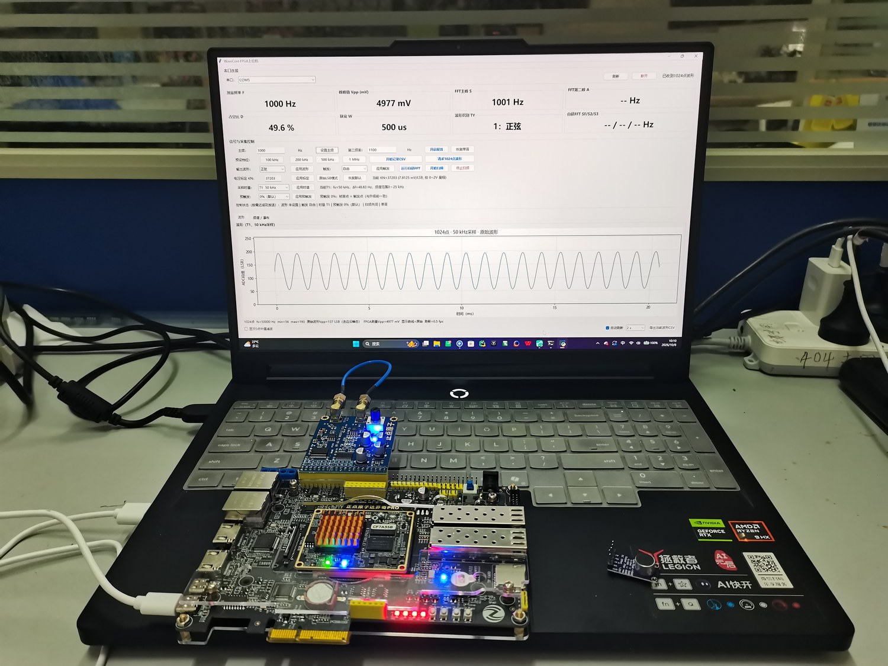

# WaveCore

**基于 FPGA 的多功能信号测量与频谱分析系统**
A multi-function signal measurement & spectrum analysis system based on FPGA.

> 全国大学生嵌入式芯片与系统设计竞赛 2026 · FPGA 赛道（AMD）· 自主选题（初级组）
>
> **状态更新：2026-10-25** ｜ 串口 **460800-8N1** ｜ 协议 **v1.24**（28 条命令）
>
> 全链路已上板验证 ✅ ｜ **已 Flash 固化（断电自启，无需 Vivado）**



## 三项核心指标

| 指标 | 数值 | 说明 |
|---|---|---|
| **弱信号提取** | **−18.8 dB SNR 下误差 0.8%** | 同一时刻常规 Vpp 偏 12 倍（3487 mV vs 真值 290 mV） |
| **频率测量** | **100 Hz ~ 1 MHz，误差 <1%** | 闸门法 / 测周法自动切换，1 MHz 时误差 0.01% |
| **整片占用** | **LUT 37.91%，WNS +0.613 ns** | 十六项特性共用一套引擎，零失败端点 |

---

## 一句话

一块 Artix-7，把 **信号产生 → 采集 → 参数测量 → 波形识别 → 频谱分析 → 弱信号提取 → 可视化**
全部做进板内。**板内 DDS 经 DAC 输出、飞线回环到 ADC**，因此
**不接任何外部仪器也能完整自测**。

## 系统数据流（一条龙）

```
电脑(命令) ──串口下行──▶ FPGA
  ▲                          │
  │  DDS(NCO+正弦表) → 数字正弦 → DA(AD9708) → 模拟 → AD(AD9280) → 数字信号
  │                          │                 (DA→AD 回环 = 自测通道;
  │                          │                  外部信号也可直接从 AD 进)
  │                          ▼
  │              ┌─ 自动测量：频率(100Hz~1MHz<1%) + Vpp + 占空比/脉宽
  │              ├─ 波形识别：规则法 + 神经网络，0x96 三态（强制A/强制B/自动择优）
  │              ├─ 频谱：自研 1024 点（Hann 窗 + 抛物线插值，0~6.25MHz）
  │              │        厂商 IP 4096 点（0~25kHz）
  │              ├─ 锁相放大：正交解调 + 整周期累加，0x99 噪声注入 / 0x9B I-Q 帧
  │              ├─ 触发采集（自由/上升沿/下降沿）+ 预触发（0/25/50/75%）
  │              ├─ 时基四档：T1/T2 低频、T3/T4 高频频谱档（最高 6.25MHz）
  │              └─ 波形上传(0x83) / 幅度谱帧(0x8E) → 上位机波形·频谱·瀑布图
  │                                   │
  └──────────────── PC 上位机 ◀───┘
```

## Features / 功能（均已上板验证 ✅）

| # | 功能 | 说明 | 验证数据 |
|---|------|------|---------|
| 1 | **DDS 信号源** | 32bit NCO + 正弦表；预设 100k/200k/500k/1M（按键/LED）；**任意频率 `0x85`（1Hz~12.5MHz）**；**双音合成 `0x87`** | 37.5kHz 自测 `F=0037500`；频率分辨率 **0.0116 Hz** |
| 2 | **ADC 采集** | AD9280（25MSPS）+ DA→AD 回环自测；5 点中值滤波先于抽取 | 回环 Vpp ≈ **5050 mV**（标定后） |
| 3 | **自动测量** | 频率 **100Hz~1MHz 误差 <1%**（闸门法/测周法自动切换）；Vpp / 占空比 / 脉宽；**四层数字抗噪** | 1k/5k/37.5k/100k/1M 逐字精确；方波 D=49.9~50.4% |
| 4 | **电压标定 `0x8C`** | `V= 计数 × KN ÷ 1024`；**KN=37203（36.33 mV/LSB）已固化 Flash** | 万用表实测标定；**外部验证 1~4V 最大偏差 2.8%、平均 0.8%** |
| 5 | **自研 FFT** | **1024 点 Radix-2 DIF**，16 位定点；`0x8A` 按需运行 → `SF=/S2=/S3=` 三峰；**Hann 窗 + 抛物线插值** | 方波 `999 / 2998 / 4997`（真值 1000/3000/5000，**误差 <0.1%**）；资源 **502 LUT / 346 FF / 7 DSP** |
| 6 | **泄漏与插值** | 矩形窗泄漏 **14.7% → 0.9%**；插值修正 **976Hz → 999Hz**（2.4% → 0.1%） | `USE_HANN` / `USE_INTERP` 可回退 |
| 7 | **厂商 IP FFT** | **4096 点**；服务 0~25kHz。⚠️ 该核在抽取比低于 100 时无法完成一帧，故不用于高频段 | 1k+1.1k 双音分开：`S=1001 + A=1099` |
| 8 | **★ 数字锁相放大** | 正交解调 + **整周期累加**；参考 NCO 跑 25MHz 取 2×fcw，与 DDS 严格同频；旋转因子复用 FFT 的 ROM。命令：`0x99` 噪声注入 / `0x9A` 使能 / `0x9B` 读 I/Q / `0x9C` 积分周期 | **−18.8 dB SNR 下误差 0.8%**；同一时刻直接测量 3487 mV（真值 290 mV，偏 12 倍） |
| 9 | **★ 波形识别 · 自动选源** | 规则法与神经网络**始终并行**；`0x96` 三态：强制规则法 / 强制神经网络 / **自动择优**。自动模式三层判据：一致则采信、一方不确定则信另一方、仅分歧时按频率仲裁 | **1k~200kHz 三波形 18/18 全对**，优于任一单方法 |
| 10 | **触发采集 `0x89`** | 自由 / 上升沿 / 下降沿；**支持慢边沿**（armed 状态位检测）；帧首点＝触发点 | 1kHz / 100Hz 正弦均可触发 |
| 11 | **预触发 `0x8F`** | **0% / 25% / 50% / 75%** 四档；50% 时触发点落在数据帧**正中央** | **四档逐点精确**（0/256/512/768，误差 0）；代价仅 +13 LUT / +29 FF / 0 DSP |
| 12 | **时基四档 `0x8D`** | T1 50k / T2 12.5k（低频）；**T3 6.25M / T4 12.5M（高频频谱档，最高观测 6.25MHz）** | 换档后频谱横轴同步变化；T3/T4 往返五轮稳定 |
| 13 | **幅度谱帧 `0x8E`** | 512 点对数压缩幅度谱（518 B ≈ 11.2 ms）；上位机画**实时频谱 + 瀑布图** | 帧率 **21.2 帧/s**（效率 91%） |
| 14 | **扫频 `0x8B`** | 1k→20k，步进 100Hz，50ms/步，循环 | 瀑布图呈斜线 ✅ |
| 15 | **波形上传 `0x83`** | 上传最近 **1024 点**；支持触发对齐与预触发回退 | PC 画出 1kHz 波形 ✅ |
| 16 | **频域处理组** | 窗函数三档 `0x90` / 50% 帧重叠 `0x91` / **IFFT 频域滤波 `0x92`** / DAC 回放 `0x93` / 自适应选窗 `0x97` / **谱平均 8 帧 `0x98`** | 底噪 81.6→25.6；谱帧 35→24ms；**谱平均帧间标准差 14.5→1.05（底噪均值不变）** |
| 17 | **资源与时序** | **LUT 7886 (37.91%) / FF 7082 (17.02%) / BRAM 12 (24.00%) / DSP 40 (44.44%)**；**WNS +0.613 ns**、WHS +0.057 ns，**0 失败端点** | 资源攻坚前 LUT 曾 **100.14% 超容**（见下） |
| 18 | **Flash 固化** | `.mcs` 写入板载 Flash，**断电重启即用**，现场不依赖电脑 | 断电复验 `V=5013`（偏差 0.73%）✅ |

## 工程亮点（评审视角）

1. **两条 FFT 通路分工覆盖，不是等价替换。**
   自研 1024 点核覆盖 **0~6.25MHz** 全频段；厂商 4096 点 IP 核服务 **0~25kHz**。
   两者点数、频段、目标都不同：IP 提供低频高分辨率参考，自研核追求**轻量（502 LUT，约 IP 的 1/3）、
   可解释（全 RTL 可读）、高频适配**。本仓库同时报告总资源、单点资源、频段与精度，
   **不宣称两者可互相替代**。

2. **每个关键算法都有两套独立实现，并各自给出边界。** 这是本项目的方法论核心：
   | 对照轴 | 两套实现 | 结论 |
   |---|---|---|
   | 频谱 | 自研定点 FFT vs float64 金标准 | 归一化 RMSE 1.24×10⁻³（−58 dB），峰值 bin 全一致 |
   | 识别 | 规则法 vs 神经网络 | 强项互补（规则法方波 400k，NN 正弦 400k），自动 18/18 |
   | 测频 | 闸门法 vs 测周法 | 误差来源不同，交接点取 10 kHz |

3. **测量通路与观察通路解耦**：频率计/波形识别直接测原始采集流，**不经时基抽取**；
   切换时基只改变"怎么看"，`F= / V= / D= / W= / TY=` 纹丝不动。

4. **资源攻坚**：实现阶段 LUT 一度 **20,829 > 20,800** 超容（只超 29 个就 `[DRC UTLZ-1]` 中止）。
   根因是 `fft_demo.v` 的 `f_ram`（4096×8）**从未进块 RAM** —— 读口的异步复位让 Vivado 放弃推断，
   退化成 32,768 个 FDRE + 4096:1 读 mux，独占全设计 86% LUT / 93% FF。
   改用教科书 SDP 模板后 **LUT 20,829 → 5,117（−75.4%）**。详见 `report/lut_slim_report.md`。

5. **会推翻自己的结论。** 本项目曾长期宣传"双 FFT 互为参照"，实测发现 IP 核在抽取比 <100 时
   无法完成一帧后，**这个说法被我们自己撤掉**，改写为"分工覆盖"。
   同类修正还有：谱平均原写"底噪下降 4.5dB"（错，平均只降方差不动均值）、
   锁相原报 −13dB/2.1%（错，真值算法把截断误差算到了锁相头上）。
   **能说出自己哪里不行，比说出哪里行更难。**

6. **可复现**：所有结论都能按 [`report/evidence_index.md`](report/evidence_index.md) 的索引复现，
   协议帧全部过审计器（`hw_analysis/check_protocol_frames.py`）。
   **不用板子也能复现的有 5 项**（纯计算），需要上板的各自标明了测试条件。

## Hardware / 硬件平台

- 主控板：正点原子**达芬奇 Pro**（AMD Artix-7 **XC7A35T-2FGG484**）
- 模拟模块：**ATK_HS_AD_DA**（AD9708 DAC / AD9280 ADC），输入端 **±5V** 量程
- 人机交互：**PC 上位机（Python）**（波形 / 仪表 / 频谱 / 瀑布图 / 提示面板）
- ~~STM32F407 + 淘晶驰串口屏~~（2026-09-20 决策取消，改统一 PC 上位机；F1 转发口代码保留备用）

## Environment / 开发环境

- Vivado **2020.2**；上板验证用 ILA + 串口
- 编码双轨：仓库 **UTF-8** / Vivado 工程 **GBK**（转换脚本 `hw_analysis/to_gbk.py`）
- 上位机需 **Python 3.8**（含 pyserial / numpy / matplotlib）

> ⚠️ **ROM 初始化文件用了绝对路径。**
> `src/hann_rom.v`、`blackman_rom.v`、`sine_rom.v`、`twiddle_rom.v`、`wave_nn.v`
> 这 5 个文件里的 `$readmemh` 写死为 `D:/Verilog_project/wavecore/src/*.hex`。
>
> **换机器或换目录时，先跑一次重定位：**
> ```
> python build/relocate.py --root <你的工程根目录>          # 预览
> python build/relocate.py --root <你的工程根目录> --apply  # 执行
> ```
>
> 为什么必须显式处理：`$readmemh` 找不到文件时**综合可能不报错**，
> ROM 会变成 X / 0，上板后波形全错却不报错 —— 这类故障极难定位。

## 怎么玩（快速上手）

**前置**：板子已固化 Flash，**插 USB 上电即出数据**（460800），无需 Vivado。

1. **接回环飞线**（DA 输出 → AD 输入），上电
2. 双击 `host/run_gui.bat` 打开上位机 → 应看到 `F=` `V=` `D=` `W=` `TY=` 实时刷新
3. **录制/演示前先复位**：双击 `host/run_demo_reset.bat`（一键回到 1kHz 正弦、噪声关、锁相关）
4. **先设 1kHz**（上电默认是 100kHz 预设，而自研谱 fs=50kHz，100kHz 会混叠）：
   HEX 发 `5A A5 85 00 04 E8 03 00 00 74`

### 常用命令帧（460800-8N1，可直接粘贴）

| 操作 | HEX 帧 |
|---|---|
| 设 1000Hz | `5A A5 85 00 04 E8 03 00 00 74` |
| 正弦 / 方波 / 三角 | `5A A5 88 00 01 00 89` / `… 01 8A` / `… 02 8B` |
| 触发：自由 / 上升 / 下降 | `5A A5 89 00 01 00 8A` / `… 01 8B` / `… 02 8C` |
| 请求 1024 点波形 | `5A A5 83 00 01 00 84` |
| 自研 FFT 运行 | `5A A5 8A 00 01 00 8B` |
| 扫频 开始 / 停止 | `5A A5 8B 00 01 01 8D` / `5A A5 8B 00 01 00 8C` |
| 时基 T1 / T2 / T3 / T4 | `5A A5 8D 00 01 00 8E` / `… 01 8F` / `… 02 90` / `… 03 91` |
| 预触发 0% / 25% / 50% / 75% | `5A A5 8F 00 01 00 90` / `… 01 91` / `… 02 92` / `… 03 93` |
| 识别来源：自动 / 规则法 / NN | `5A A5 96 00 01 02 99` / `… 01 98` / `… 00 97` |
| 幅度谱帧请求 | `5A A5 8E 00 00 8E` |
| **噪声注入 level6/att3** | `5A A5 99 00 02 06 03 A4` |
| **噪声注入 level8/att4（最深）** | `5A A5 99 00 02 08 04 A7` |
| **噪声关** | `5A A5 99 00 02 00 00 9B` |
| **锁相开 / 关** | `5A A5 9A 00 01 01 9C` / `5A A5 9A 00 01 00 9B` |
| **读 I/Q 帧（锁相）** | `5A A5 9B 00 00 9B` |
| **积分周期 32** | `5A A5 9C 00 02 20 00 BE` |
| 标定恢复默认（KN=37203） | `5A A5 8C 00 04 53 91 00 00 74` |

> ⚠️ **静默命令**（`0x8A / 0x8B / 0x8D / 0x8E / 0x99 / 0x9B`）**没有回显**，
> "发过去没反应"是正常的 —— 只能靠可观察量判断（谱峰 bin 号、波形周期数、瀑布图、Vpp 读数变化）。

5. 一键小工具（`host/`）：
   `run_gui.bat`（主界面）、`run_demo_reset.bat`（录制前复位）、
   `run_demo_weak.bat`（**微弱信号演示，三步走**）、`run_waterfall*.bat`（频谱/瀑布）、
   `run_check_interp.bat`（插值精度）、`run_check_pretrigger.bat`（预触发）、
   `run_link_scan.bat`（模拟链路频响）、`release_com.bat`（释放被占串口）

## 已知限制（诚实说明）

| 限制 | 说明 |
|---|---|
| **时域波形固定 50 kHz 采样** | 因此**看波形**只能到 25 kHz（奈奎斯特）。这是**时域通路**的限制，不是整机的；频谱通路走另一条路，最高到 **6.25 MHz** |
| **IP 核只服务 0~25 kHz** | 该 4096 点核在抽取比低于 100（采样率 >500 kHz）时无法完成一帧，且无复位端口，进坏状态只能重配器件。高频谱线全部由自研 FFT 提供 |
| **自研 FFT 只扫 bin 1~511** | 可用范围 T1 48.8~24951 Hz、T2 12.2~6238 Hz；越界分量会**混叠折叠**成 `fs−f` 并报出看似合理的错误值，主机端已就此标注 |
| **波形识别上限 200 kHz** | 超出后统一报"其他"。实测方波可达 400 kHz、正弦 250 kHz 起不稳（且与相位相关），取 200 kHz 作为对所有波形都成立的保守值 |
| **测周法有约 0.3% 系统偏差** | 10 kHz 以下启用测周法，折算约少算 580 拍，**成因未定位**。它落在承诺的 <1% 之内，但已如实记录 |
| **波形 RAM 为单口** | 发送期间停止采集，存在"死区"；实测 **21.2 帧/s**（效率 **91%**） |
| **模拟链路谐波衰减大** | 回环方波 3 次谐波实测 −30dB（理论 −9.5dB），**THD 演示不宜用回环方波** |
| 带内漂移 | 正弦占空比冷机 50% → 热机 46.8%（模拟链温漂），建议预热 3 分钟、以方波为基准 |

## 未做（明确边界）

- ❌ **传感器实测**（MAX9814 麦克风 / 振动模块）—— **未接入，未实测**；
  选型与接线方案仅作留档，见 `report/sensor_frontend_guide.md` 与 `report/ne5532_sensor_circuit.md`。
  锁相放大目前用**板内回环 + 伪随机噪声**验证算法，**尚未接入真实传感器**
- ❌ **自研 4096 点 FFT**（已评估：插值已把误差压到 0.1%，性价比低，**决策不做**）
- ❌ 串口屏方案（2026-09-20 取消）
- ❌ 音乐彩蛋（需额外麦克风硬件）

## Directory Structure / 目录结构

```
wavecore/
├── README.md          # 项目简介 + 复现步骤（本文件）
├── src/               # 源码（Verilog，38 个源文件）
│   ├── board_top.v            # 顶层：时钟/复位/各模块互联与 TX 互斥仲裁
│   ├── dds_nco / sine_rom / dual_tone                 # 信号源
│   ├── ad_driver / freq_meter / measure_report        # 采集 · 测量
│   ├── wave_id / wave_feat / wave_nn                  # 识别：规则法 + 6-16-4 神经网络
│   ├── lockin_core / lockin_frame / sig_noise         # 锁相：解调/整周期累加/I-Q 帧/噪声注入
│   ├── fft_demo / fft_report                          # 厂商 IP 4096 点通路
│   ├── self_fft_1024 / self_fft_report / twiddle_rom  # 自研 1024 点通路
│   ├── hann_rom / blackman_rom                        # 窗表
│   ├── spec_compress / spec_buf / spec_frame / spec_avg   # 0x8E 谱帧 / 0x98 谱平均
│   ├── wave_frame / timebase / sweep_ctrl / freq_ctrl # 波形帧 · 时基 · 扫频
│   ├── cmd_decoder                                    # 命令解析（含 KN_DEF 标定默认值）
│   └── uart_tx / uart_rx / uart_mirror / bin2bcd
├── build/             # 构建与烧写脚本（create_project / reset_and_build / gen_mcs / program_flash）
├── sim/               # 仿真：fft_check(6 场景+11 项) / mv_check / fft_demo_check / board_elab
├── board/             # XDC、引脚表、串口协议 v1.24、复验清单、flash_guide
├── host/              # 上位机：protocol.py + 一键工具（波形/仪表/频谱/瀑布图/微弱信号演示）
├── hw_analysis/       # 验证脚本与数值金标准（probe_interp / verify_hann_window / check_protocol_frames …）
├── skill/             # 技能包 SK-001~083（抗噪/触发/FFT四坑/固化/量化定标/时序/文档一致性/空读纪律等）
└── report/            # 设计报告 / 精度标定 / 技术专题 / LLM 记录 / figures（配图与生成脚本）
```

## How to Reproduce / 复现步骤

1. Vivado 2020.2 打开 `wavecore.xpr`（或按 `build/` 的 tcl 重建）
2. Add Sources：`src/*.v`；IP：`xfft_0`（4096 点 FFT）、`blk_mem_gen_0`（1024×8 波形缓存）、
   `blk_mem_gen_1`（自研 FFT 存储）、`hann_rom`、`ila_0`（`ILA_EN` 置 `1'b0` 可一键关闭）
3. 约束用 `board/wavecore.xdc`
4. 综合 → 实现 → 生成 bitstream → Program Device
5. 按"怎么玩"验证；若要断电自启，用 `build/gen_mcs.bat` + `build/program_flash.bat` 固化 Flash
6. 复现关键指标：`hw_analysis/` 下的脚本（`probe_interp` 复现 976→999、`verify_hann_window` 复现泄漏比、
   `check_protocol_frames` 审计全部命令帧）

## 演示与交付材料

- **技术文档**：`技术文档_WaveCore.pdf`（25 页，14 张图：系统框图、接口示意、完整测试连接、软件架构、6 张流程图、实物照片）
- **演示视频模板**：`视频模板/WaveCore_demo_template.mp4`（2 分 55 秒，片头 + 16 项功能 + 片尾）
- **答辩稿 / 提词卡**：`答辩稿_WaveCore.md`、`答辩提词卡_一页.md`
- **微弱信号演示脚本**：`host/run_demo_weak.bat`（三步走：干净 → −0.6dB → −18.8dB）

## 文档索引

- **★ 证据索引表**：`report/evidence_index.md` —— 每个数字的「测试条件 → 脚本 → 原始输出 → 证据」四件套，
  含「已撤销的说法」一节（三条被自己实测推翻的结论，保留修正轨迹）
- **设计报告**：`report/design_report.md`
- **串口协议**：`board/uart_protocol.md`（**v1.24**，28 条命令，命令号分配表 §4.1 是唯一事实源）
- **精度标定**：`report/accuracy_calibration.md`
- **锁相 SNR 曲线**：`report/lockin_snr_curve.md`（含"真值算法自己会让锁相背锅"的修正记录）
- **工程问题复盘**：`report/engineering_challenges.md`（12 个真实案例）
- **LLM 协作记录**：`report/llm_collab_log.md`（58 条）
- **技能包（踩坑总结）**：`skill/README.md`（**SK-001~083**，83 条）
- **技术文档 vs 官方要求核对**：`report/tech_doc_vs_requirement.md`

### 命令号速查（v1.24）

| 命令 | 功能 | 判据 |
|---|---|---|
| 0x90 | 窗函数切换（矩形/Hann/Blackman） | 底噪 81.6 / 25.6 / 25.2，矩形是另两档 3.2 倍 |
| 0x91 | 50% 帧重叠 | 取频谱 35ms → 24ms |
| 0x92 | IFFT 频域滤波（掩膜） | 掩 5 个 bin 压制 34dB |
| 0x93 | DAC 回放 IFFT 结果 | 示波器可见滤波后波形 |
| 0x94 | 内部状态回读（调试用） | SF/S2/S3 三行 |
| 0x95 | 神经网络识别结果回读 | 类别 / 占空比 / 峭度 |
| 0x96 | **识别来源切换（三态）** | 自动 / 规则法 / 神经网络 |
| 0x97 | 自适应选窗 | 整 bin→矩形、半 bin→Hann |
| 0x98 | 幅度谱 8 帧平均 | 帧间标准差 14.5 → 1.05，**底噪均值不变** |
| 0x99 | **噪声注入**（level 0~15, att 0~4） | 用于锁相演示，Vpp 读数明显变化 |
| 0x9A | **锁相使能** | 关闭时累加器清零 |
| 0x9B | **请求 I/Q 帧** | `5A A5 03` 帧头，I/Q 各 6 字节 + N |
| 0x9C | **锁相积分周期**（1~4096） | 默认 32，1kHz 下约 32ms |
| 0x9D | 波形识别内部量回读（调试用） | 占比 / 峭度等 |
| 0x9E | IP FFT 上报状态回读（调试用） | 定位过"切 T3/T4 后 S= 停发" |
| 0x9F | 波形识别状态回读（调试用） | |

## License

MIT License, see [LICENSE](LICENSE).
